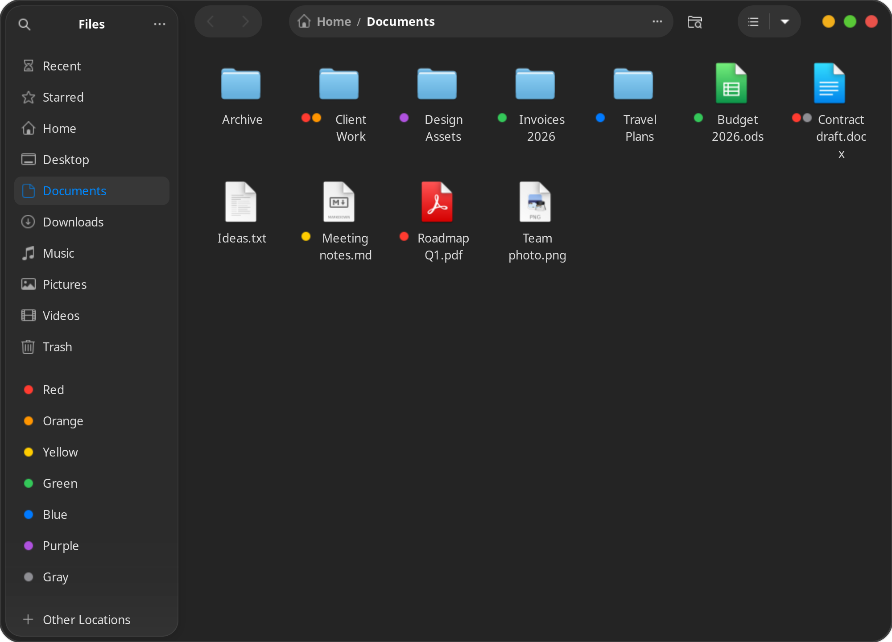
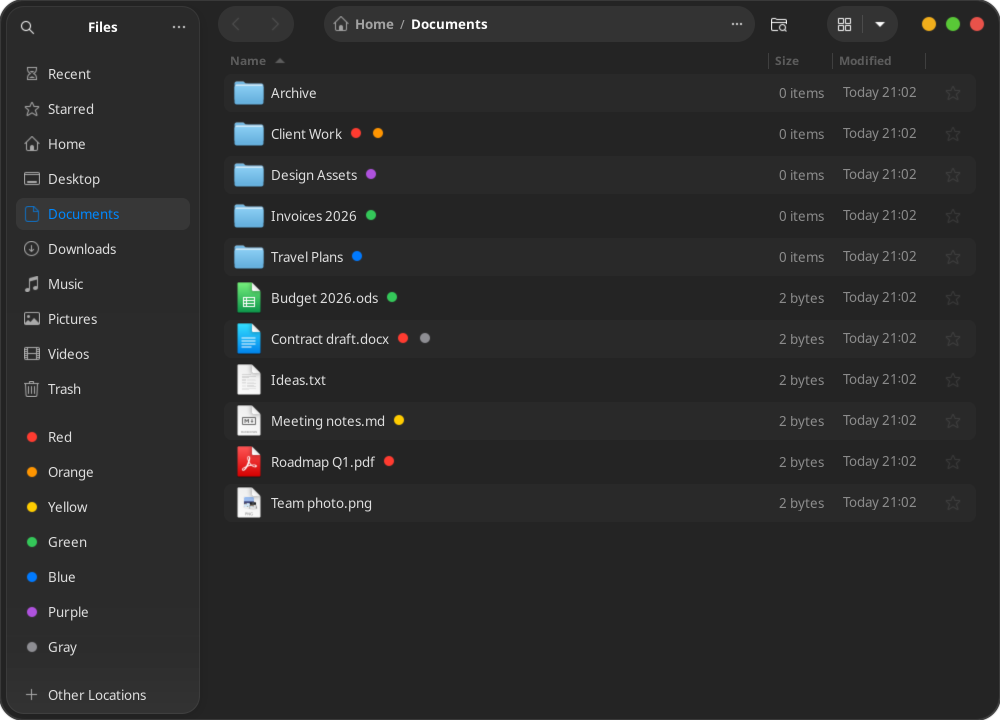
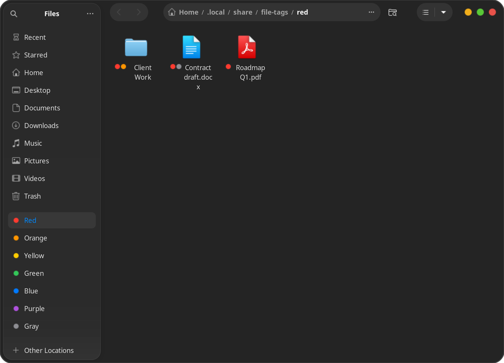

# Nautag

Finder-style colour tags for Nautilus (GNOME Files) on Ubuntu 24.04: right-click a file → **Tags**, get a coloured dot on it and a list of tagged files in the sidebar.

| List view | A tag's folder |
| --- | --- |
|  |  |

## What you get

- **Seven Finder colours** in the right-click menu (Tags → Red, Orange, …), on one or many files and folders.
- **Coloured dots** before the name in grid view and after it in list view.
- **Tags in the sidebar**: click one to see everything with that tag, wherever it lives.
- **Tags stay on the file** (`user.xdg.tags` extended attribute, which Dolphin reads too), so they survive renames and moves.

## Install

    unzip nautag-1.0.zip && cd nautag   # or clone the repo
    ./install.sh    # asks for sudo once if python3-nautilus is missing
    nautilus -q     # restart Nautilus

- **Rename a tag:** right-click it in the sidebar → Rename.
- **Untag:** right-click → Tags → the checked colour. Deleting the link in a tag folder is undone by the next sync, because the tag lives on the file.
- **Sync:** moved or renamed files reappear in their tag folder within 10 minutes (`python3 ~/.local/share/nautilus-python/extensions/file_tags.py rescan` does it now). Hidden folders and `node_modules` are not scanned.
- **Tags get lost** on filesystems without xattrs (FAT/exFAT), in `git`, and in tools that do not copy xattrs (`cp` without `-a`, `rsync` without `-X`).

- **After a Nautilus upgrade:** the dots beside names and in the sidebar come from editing Nautilus's own widgets, tested on Nautilus 46. If a new version changes its layout, the dot falls back to sitting beside the icon and the sidebar shows a folder icon again; tagging itself keeps working.

Tests: `python3 test_file_tags.py`

## Uninstall

    systemctl --user disable --now file-tags-rescan.timer
    rm ~/.config/systemd/user/file-tags-rescan.* ~/.local/share/nautilus-python/extensions/file_tags.py
    rm -r ~/.local/share/file-tags
    sed -i '\|/.local/share/file-tags/|d' ~/.config/gtk-3.0/bookmarks
